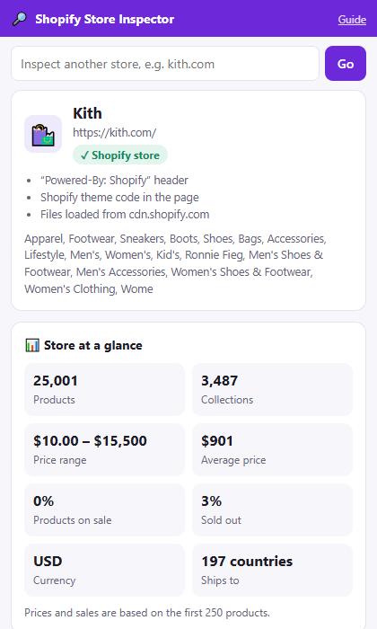
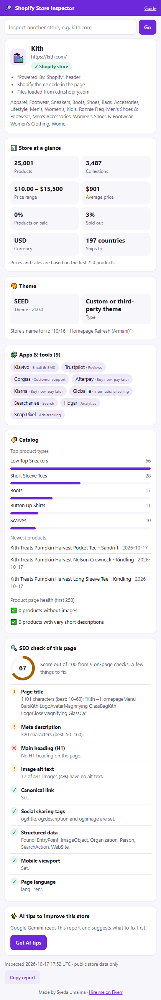

# 🔎 Shopify Store Inspector

A Chrome extension (and website) that inspects any online store in one click: **is it Shopify, which theme and apps, how big is the catalog, what are the prices**, plus an **SEO check** of the page and **AI tips** on what to improve.

**Live site:** https://shopify-store-inspector.vercel.app · [Download the extension](https://shopify-store-inspector.vercel.app/static/shopify-store-inspector.zip), or [inspect a store online](https://shopify-store-inspector.vercel.app/inspect) without installing anything.

<p>
  
  
</p>

## Features

- **Shopify detection** with the evidence (headers, theme code, Shopify CDN files)
- **Store at a glance:** product and collection counts, price range, average price, % on sale, % sold out, currency, shipping countries
- **Theme:** name, version, and Theme Store vs custom
- **Apps & tools:** 40+ apps recognised (Klaviyo, Judge.me, Yotpo, Afterpay, Klarna, Gorgias, Recharge…) plus Shopify theme app embeds
- **Catalog:** top product types, newest products, products missing images or descriptions
- **SEO check:** 9 on-page checks (title, meta description, H1, image alt text, canonical, social tags, structured data, viewport, language) with a score out of 100
- **AI tips:** Google Gemini turns the report into 5 prioritised, specific suggestions
- **Copy report** as text for emails and proposals
- Works on non-Shopify sites too (the SEO check still runs)
- **Privacy-friendly:** one permission (`activeTab`), nothing stored, no tracking

## How it works

```
Extension popup ──(tab URL)──► /api/inspect ──► store's public pages
                                    │             • the page HTML + headers  → Shopify? theme, apps, SEO
                                    │             • /meta.json               → name, currency, counts
                                    │             • /products.json           → prices, sales, stock, types
                                    ▼
                               JSON report ──► rendered by report.js (same code on the website)
                                    │
                         "Get AI tips" ──► /api/tips ──► Gemini ──► 5 tips
```

The page is fetched safely: only public `https` sites, no IP addresses or local hosts, limited redirects and size.

## Install the extension

1. Download [shopify-store-inspector.zip](https://shopify-store-inspector.vercel.app/static/shopify-store-inspector.zip) from the website and unzip it.
2. Open `chrome://extensions` and turn on **Developer mode**.
3. Click **Load unpacked** and select the unzipped folder.
4. Pin the 🔎 icon and click it on any store.

## Tech stack

| Part | Technology |
|---|---|
| Extension | Chrome Manifest V3, JavaScript, `activeTab` |
| Backend | Python, FastAPI |
| AI | Google Gemini (free tier), JSON mode |
| Hosting | Vercel |

## Run it on your computer

1. Get a free Gemini API key at https://aistudio.google.com/apikey
2. In a terminal:
   ```bash
   git clone https://github.com/imumaimabukhari-123/shopify-store-inspector.git
   cd shopify-store-inspector
   python -m venv venv
   venv\Scripts\activate          # on Mac/Linux: source venv/bin/activate
   pip install -r requirements.txt
   copy .env.example .env         # on Mac/Linux: cp .env.example .env
   ```
3. Open `.env` and paste your key after `GEMINI_API_KEY=`.
4. Run `python app.py` and open http://127.0.0.1:8004
5. Load the `extension/` folder in Chrome (it uses the local server by default, see `extension/config.js`).

To build the download zip for a deployed site: `python tools/build_zip.py https://your-site.vercel.app`

## API

| Endpoint | Returns |
|---|---|
| `GET /api/inspect?url=kith.com` | The full report as JSON |
| `POST /api/tips` with `{"report": {...}}` | `{"tips": [{"title", "detail", "impact"}]}` |

## Need a custom extension or Shopify tool?

I build Chrome extensions, Shopify stores and AI tools.

**Syeda Umaima** · ✉️ [imumaimabukhari@gmail.com](mailto:imumaimabukhari@gmail.com) · [Hire me on Fiverr](https://www.fiverr.com/umaima886) · [GitHub](https://github.com/imumaimabukhari-123)
